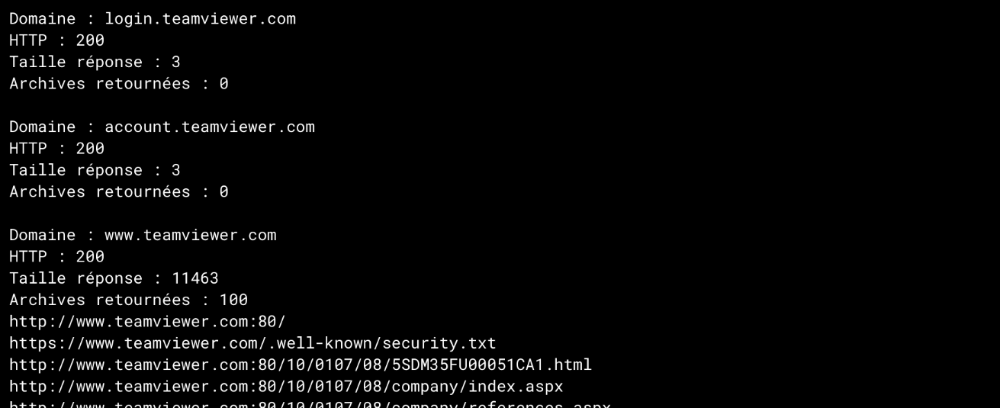
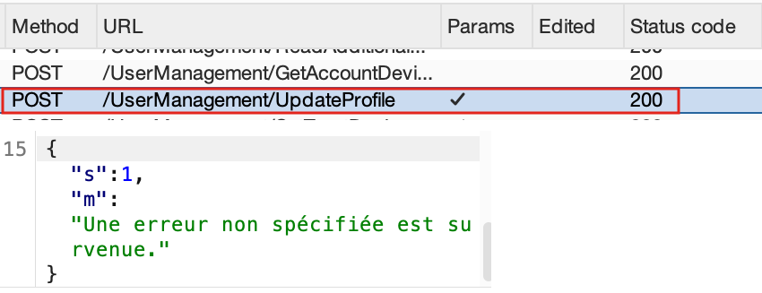
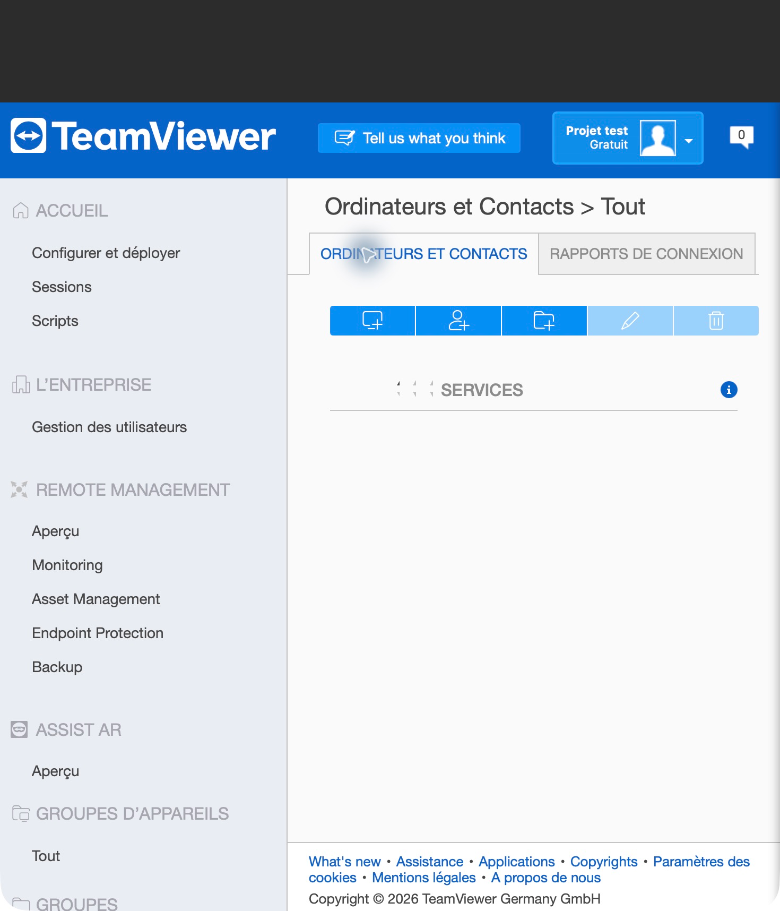
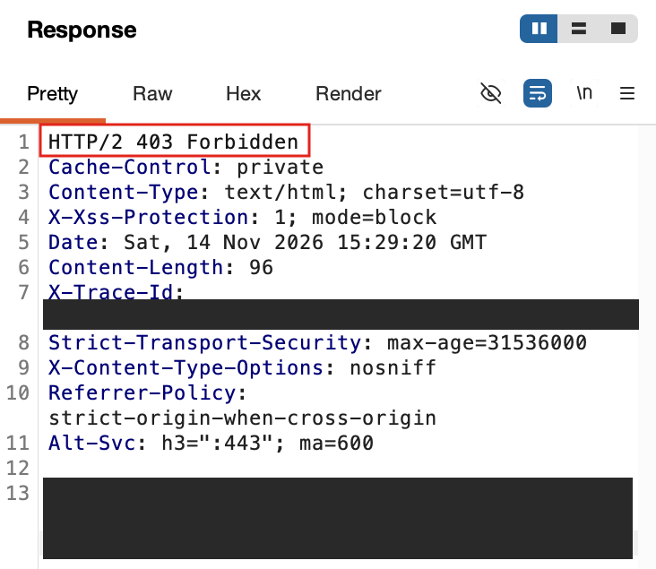
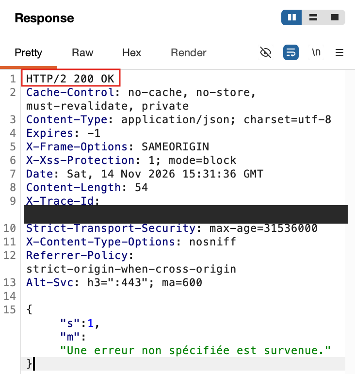
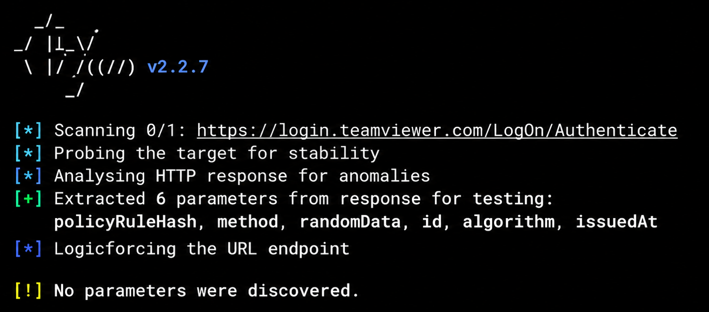
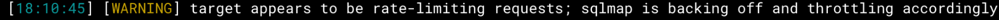

# TeamViewer — parcours de lecture des preuves

Ce dossier suit la démarche d’enquête. Les captures ont été recadrées et les données sensibles masquées.

[Revenir au parcours des fiches](../README.md).

1. [Repérer la cible et ses archives](#1-repérage-et-archives)
2. [Observer la récupération et la session](#2-récupération-et-session)
3. [Comparer les réponses Burp](#3-comparaison-dans-burp)
4. [Lire les résultats des outils](#4-résultats-des-outils)
5. [Conclure](#5-conclusion)

## 1. Repérage et archives

La [fiche cible](../fiche-cible.md) présente la console et le périmètre de l’enquête. Le [relevé de connexion](../notes/reperage/pistes-login.md) décrit les en-têtes du formulaire public. Les archives portent aussi sur d’autres domaines TeamViewer.

*Figure 1 – Résultats de la recherche d’archives par domaine. Les résultats vides sont propres à cette recherche.*

Pour le détail des chemins et de l’extraction, voir les [captures Wayback légendées](sqlmap-wayback/README.md).

## 2. Récupération et session

*Figure 2 – Le site confirme la demande et annonce l’envoi d’un courriel. Sa réception est documentée dans le journal. Cette capture n’établit pas l’usage unique du lien.*

*Figure 3 – Safari conserve l’historique réseau et TeamViewer affiche une déconnexion automatique. La cause n’est pas établie. L’essai distinct de révocation est décrit dans la [note de gestion des sessions](../notes/compte-et-sessions/gestion-sessions.md).*

## 3. Comparaison dans Burp

### Référence et vérification de l’état du profil

*Figure 4 – Deux extraits de la même capture Burp. La sauvegarde normale affiche HTTP 200 et un message JSON générique d’erreur. Le [relevé comparatif](comparaison-profil.md) documente le changement de nom observé séparément.*

*Figure 5 – Le nom initial est visible après la remise en état de l’essai de référence.*

### Premier essai dans Safari

*Figure 6 – Le profil affiche le nom initial après l’essai Safari. La trace disponible ne permet pas d’établir un rejet serveur pour cet essai.*

### Comparaison dans Burp Repeater

| Condition | Réponse observée | État du profil |
| --- | --- | --- |
| Jeton invalide, première série | HTTP 403, relevé textuel | Nom inchangé |
| En-tête absent, seconde série | HTTP 403, figure 7 | Nom inchangé |
| Jeton valide rétabli, contrôle positif de la seconde série | HTTP 200, figure 8 | Nom modifié |

*Figure 7 – Réponse au contrôle sans en-tête du jeton. Burp affiche HTTP 403 Forbidden.*

*Figure 8 – Contrôle positif après rétablissement du jeton. Burp affiche HTTP 200 OK et le message générique. Le changement visible du nom est consigné dans le [relevé comparatif](comparaison-profil.md).*

## 4. Résultats des outils

*Figure 9 – Arjun extrait six noms candidats. Le résultat final ne confirme aucun paramètre caché. Voir la [note Arjun](../notes/authentification/recherche-parametres-arjun.md).*

*Figure 10 – sqlmap signale une limitation apparente. Cet extrait ne montre ni code HTTP ni résultat positif d’injection. Les statuts rapportés et les limites sont détaillés dans la [note sqlmap](../notes/authentification/analyse-sqlmap-rate-limiting-429.md).*

Autres éléments disponibles : [initialisation sqlmap](sqlmap-wayback/sqlmap-01-redirection-301.png) et [configuration de Burp](burp-conditions-expurge.png).

## 5. Conclusion

Le contrôle du jeton a été observé sur la sauvegarde du profil. Les essais avec en-tête absent ou jeton invalide ont renvoyé HTTP 403 avec nom inchangé. Le contrôle positif a renvoyé HTTP 200 avec modification visible. Aucune faille CSRF ni injection SQL n’a été démontrée dans les conditions observées.
