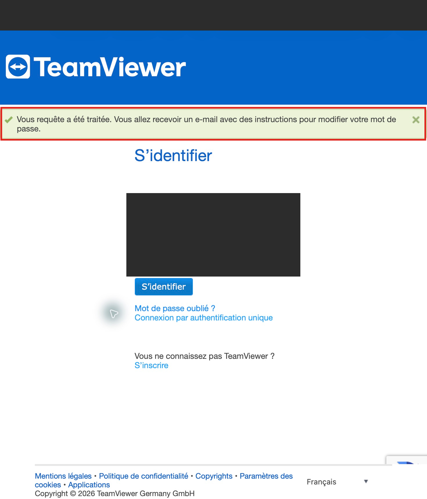
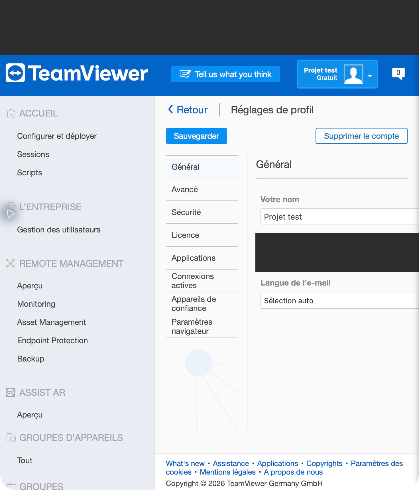
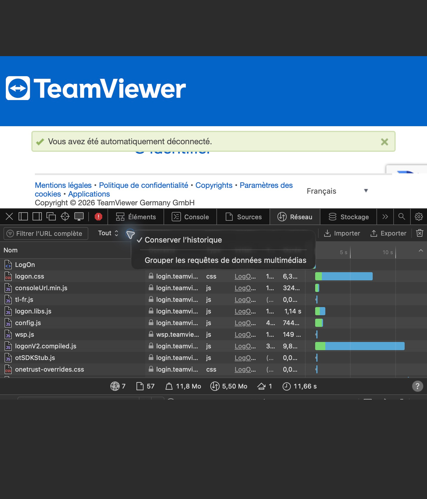

# Figures de l’investigation TeamViewer

Les cadres rouges signalent les éléments à lire. Les masques opaques couvrent les données sensibles. Les légendes indiquent exactement ce que montre chaque capture.

### Comparaison dans Burp Repeater

*Figure 1 – En-tête absent lors de l’essai documenté. Burp affiche HTTP 403 Forbidden.*

*Figure 2 – Contrôle positif après rétablissement du jeton. Burp affiche HTTP 200 OK.*

Les captures affichent les statuts. Les conditions des essais et l’effet sur le profil sont décrits dans le [relevé expurgé](comparaison-profil.md).

### Demande de récupération

*Figure 3 – Demande de récupération traitée par l’interface. Le message annonce un courriel. Sa réception est documentée séparément dans le [journal](../notes/journal.md).*

### Modification du profil

*Figure 4 – Nom initial « Projet test » visible après remise en état lors de l’essai de référence.*

*Figure 5 – Profil ouvert après l’essai Safari. Le nom affiché reste « Projet test ». La capture ne suffit pas à établir un rejet HTTP.*

Les réponses HTTP des essais Burp et l’effet sur le profil figurent dans le [relevé expurgé](comparaison-profil.md).

### Observations réseau dans Safari

*Figure 6 – « Conserver l’historique » est coché et le site affiche une déconnexion automatique. La cause de cette déconnexion reste inconnue.*

[Capture de configuration de Burp](burp-conditions-expurge.png).
